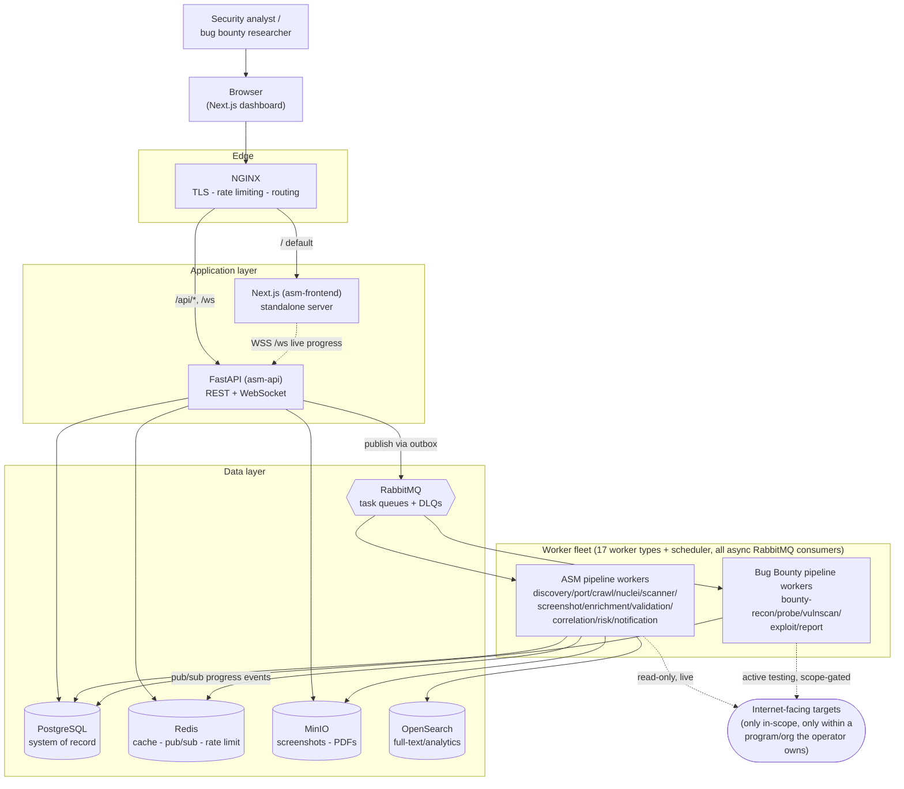
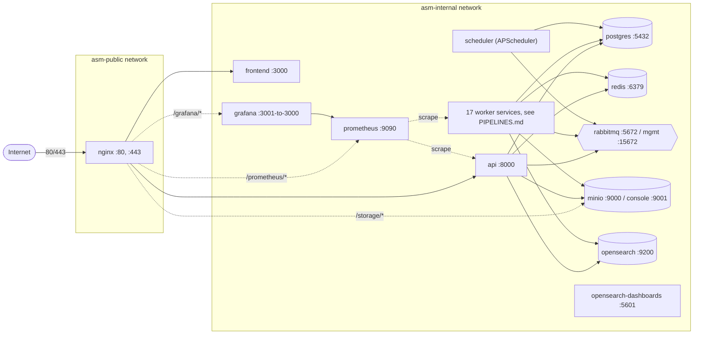
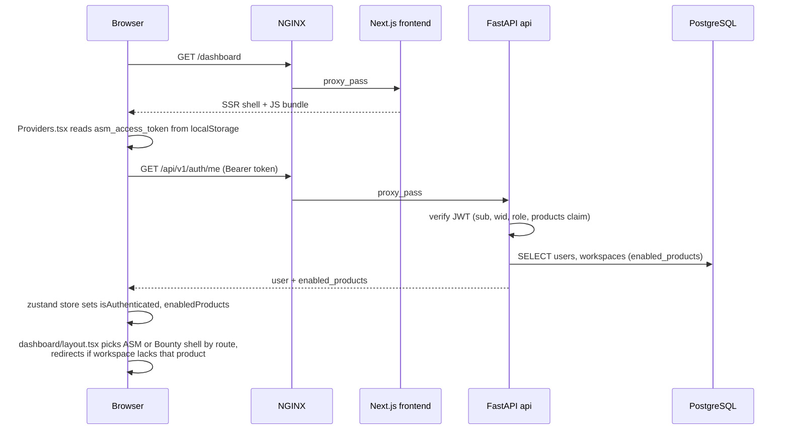
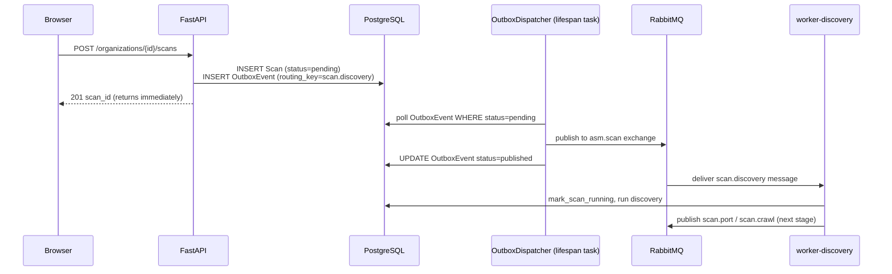

# Architecture

> Ground truth for this document was verified against the actual code (`docker-compose.yml`,
> `workers/base_worker.py`, `backend/app/main.py`, `infrastructure/nginx/nginx.conf`) on 2026-07-21,
> not copied from the previous version of this file. See [Docs vs. reality](#docs-vs-reality) at the
> bottom for what was wrong before and why.

## What this is

ASM Platform is a self-hosted platform that ships **two separate products** out of one codebase, gated
per-workspace at registration time:

1. **Attack Surface Management (ASM)** — continuous, passive discovery and monitoring of an
   organization's internet-facing footprint: subdomains, IPs, ports, endpoints, TLS posture, DNS
   health, plus nuclei-based vulnerability scanning, correlation, weighted risk scoring, and change
   notifications.
2. **Bug Bounty** — authorized, scope-gated *active* testing (recon → probe → vulnerability scan →
   exploit confirmation → report drafting) for bug bounty engagements. A deliberately separate data
   model and pipeline from ASM — see [Why two pipelines, not one](#why-two-pipelines-not-one).

A `Workspace` is entitled to one or both products (`Workspace.enabled_products`), chosen once at
registration (self-serve signup always creates a brand-new workspace — see
[DEVELOPMENT.md](./DEVELOPMENT.md)). The two products get fully separate dashboard shells in the
frontend and fully separate, workspace-gated endpoint surfaces in the API — see
[FRONTEND.md](./FRONTEND.md) and [API_REFERENCE.md](./API_REFERENCE.md).

## Tech stack

| Layer | Technology |
|---|---|
| Backend API | Python 3.12, FastAPI, SQLAlchemy 2.0 (async), Pydantic v2 |
| Workers | Python 3.12, `aio_pika` (RabbitMQ client), asyncio |
| Frontend | Next.js 14 (App Router), TypeScript, Tailwind CSS, Zustand, TanStack Query |
| Primary datastore | PostgreSQL 16 |
| Cache / pub-sub / rate limiting | Redis 7 |
| Task queue | RabbitMQ 3.13 (topic/direct/fanout exchanges, per-queue DLQs) |
| Object storage | MinIO (screenshots, PDF reports) |
| Full-text / analytics | OpenSearch 2.x (+ OpenSearch Dashboards) |
| Reverse proxy / TLS / rate limiting | NGINX |
| Observability | Prometheus + Grafana; each worker exposes its own `/metrics` |
| Active-testing / recon tooling | subfinder, amass, assetfinder, crt.sh, dnsx, httpx, naabu, katana, nuclei, wafw00f, feroxbuster, ffuf, subzy, Playwright/Chromium, sqlmap, dalfox |

## System context

## Container topology & networks

Every service runs in Docker Compose on two networks: `asm-public` (only `nginx` sits on it — the
single ingress point) and `asm-internal` (everything else, including `nginx` itself so it can reach
`api`/`frontend`). Nothing except NGINX is directly reachable from outside the host in a production
deployment; port publishes on other services (`postgres:5432`, `rabbitmq:15672`, `minio:9001`,
`opensearch-dashboards:5601`, `prometheus:9090`, `grafana:3001`) exist for local development/ops access,
not for the application's own runtime traffic. Grafana and Prometheus are *also* reverse-proxied through
NGINX now (`/grafana/`, `/prometheus/` — see the routing table below), so both a direct-port path and an
NGINX-fronted path work simultaneously; the direct ports weren't removed, the NGINX routes were added on
top. `opensearch-dashboards` is stopped by default (its own UI was found unused in a storage audit — see
`CHANGELOG.md`, 2026-07-23) but the container definition is still there; `docker compose up -d
opensearch-dashboards` brings it back with no other setup needed, since its data lives in the shared
`opensearch-data` volume regardless of whether the UI container is running.

**Worker containers mount `backend/app` read-only** (`./backend/app:/app/app:ro`) so they can import
backend models/services directly without a package install step — editing a backend module used by
workers takes effect on worker restart with **no image rebuild**; adding a new *file* or a new
dependency does need one. `workers/` itself is mounted read-write for the same live-reload convenience
in dev.

## NGINX routing

| Path | Rate zone | Upstream | Notes |
|---|---|---|---|
| `POST /api/v1/auth/login` | `auth` — 10r/m, burst 5 | `api:8000` | Tight, login-specific limit |
| `POST /api/v1/auth/register` | `auth` — 10r/m, burst 3 | `api:8000` | Even tighter (signup abuse) |
| `POST /api/v1/organizations/{id}/scans` | `scan` — 20r/m, burst 5 | `api:8000` | Scan-trigger specific |
| `/api/*` (everything else) | `api` — 200r/m, burst 50 | `api:8000` | The zone whose burst limit motivated building a real bulk-promote endpoint for Bug Bounty asset promotion instead of pacing client-side loops — see `CHANGELOG.md` |
| `/ws`, `/ws/*` | `global` | `api:8000/api/v1/ws/` | WebSocket upgrade, live scan/notification events |
| `/storage/*` | — | `minio:9000` | Direct proxy to object storage (screenshots, PDFs) |
| `/api/docs`, `/api/openapi.json` | `api` — 200r/m, burst 50 | `api:8000` | Self-hosted Scalar API reference (no CDN — see `CHANGELOG.md`, 2026-07-26); falls under the generic `/api/*` rule above, not a separate location |
| `/grafana/*` | — | `grafana:3000` | `location ^~ /grafana/`, no trailing slash on `proxy_pass` — both required (redirect loop + regex-location hijack otherwise, see `DEVELOPMENT.md` gotchas). Protected by Grafana's own login, no extra NGINX auth |
| `/prometheus/*` | — | `prometheus:9090` | `location ^~ /prometheus/`. Prometheus has no login of its own, so this one *is* additionally gated by NGINX `auth_basic` (`infrastructure/nginx/conf.d/.htpasswd`, gitignored, never committed) |
| `/health`, `/metrics` | — | `api:8000` | `/metrics` restricted to internal ranges |
| `/` (default) | `global` — 100r/m, burst 100 | `frontend:3000` | Next.js standalone server |

## Request flow: authenticated dashboard load

## Request flow: creating an ASM scan (outbox pattern)

The API never publishes directly to RabbitMQ on the request path — every scan/pipeline trigger goes
through a transactional outbox (`OutboxEvent` table) so a message is never lost to a crashed process
between "committed to Postgres" and "published to the broker."

`outbox_service.py`'s dispatcher is started/stopped in `main.py`'s FastAPI `lifespan`. The Bug Bounty
`POST /programs/{id}/run/{stage}` and `run/pipeline` endpoints use the exact same outbox path.

## Why two pipelines, not one

`BountyProgram`/`BountyTarget`/`BountyAsset`/`ExploitAttempt`/`BountyReport` (see
[DATA_MODEL.md](./DATA_MODEL.md)) never reference `Organization`/`Asset` at all — a deliberate schema
split, not an oversight: ASM is passive, continuous, monitoring-oriented, and its Asset rows can appear
without a human ever explicitly approving each one. Bug Bounty is active testing against real, live
targets and must never let passive discovery silently expand what's touched — a `BountyAsset`
(recon suggestion) is never auto-promoted to a `BountyTarget` (the human-approved, actually-testable
list), and every worker in the exploit chain re-validates scope at execution time regardless of what an
earlier stage already checked. See [PIPELINES.md](./PIPELINES.md) for the full scope-gate model.

## Docs vs. reality

Known drift this rewrite corrects, and a couple of new gotchas worth keeping visible:

- The previous version of this file (and the root `README.md`) implied Shodan/VirusTotal/AbuseIPDB/OTX
  threat-intel integration. **This was never true.** `backend/app/integrations/enrichment/engine.py` is
  explicitly a no-op plugin engine kept for import compatibility; the real enrichment path
  (`workers/enrichment/enrichment_worker.py`) is keyless ASN/RDAP/network-baseline only, by design —
  there are no intel API keys in `.env.example`. Don't reintroduce provider-keyed enrichment without
  checking this decision with the project owner first.
- Neither doc previously mentioned Bug Bounty at all — it's now roughly half the platform's endpoint
  surface and worker fleet (5 of 17 workers, 6 of the frontend's dashboard tabs).
- `README.md`'s "Adding Scanner/Enrichment Integrations" section describes a `BaseScannerPlugin`/
  `BaseEnrichmentPlugin` interface that doesn't exist in code (`backend/app/integrations/scanners/` is
  an empty package). The real extension point is `workers/scanner/*.py` / `workers/crawler/` — one file
  per tool/stage, wired directly into the queue chain.
- `report.daily` (published on a schedule by `workers/scheduler/scheduler.py`) has no consumer anywhere
  — `EXCHANGE_MAP` doesn't declare it, so nothing binds a queue to receive it. Scheduled daily-summary
  reports are silently dropped; treat them as dead code until a consumer exists. On-demand reports
  (`POST /reports/generate`) are unaffected — separate, synchronous `BackgroundTasks` path.
- Three separate queue routing tables can drift from each other: `workers/base_worker.py::EXCHANGE_MAP`,
  `workers/queue_client.py::ROUTING_CONFIG`, `backend/app/core/queue_client.py::ROUTING_CONFIG`. As of
  this writing `backend/app/core/queue_client.py` is missing `scan.scanner` — publishing to it from
  backend/API code would `KeyError`. When adding/renaming a queue, update all three.
