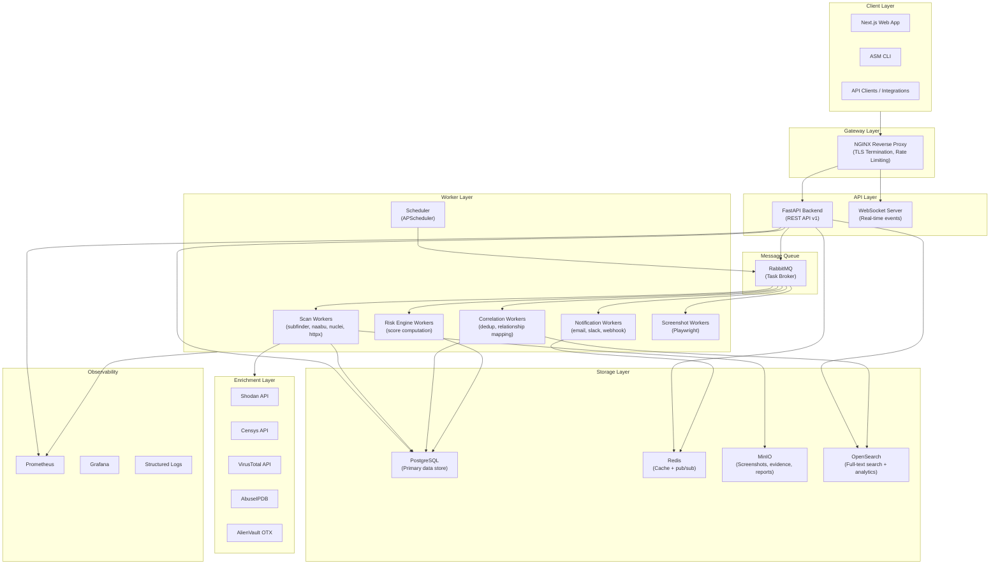
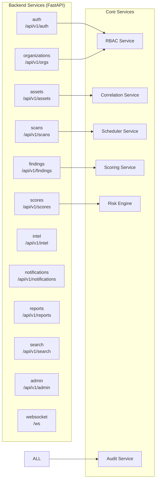
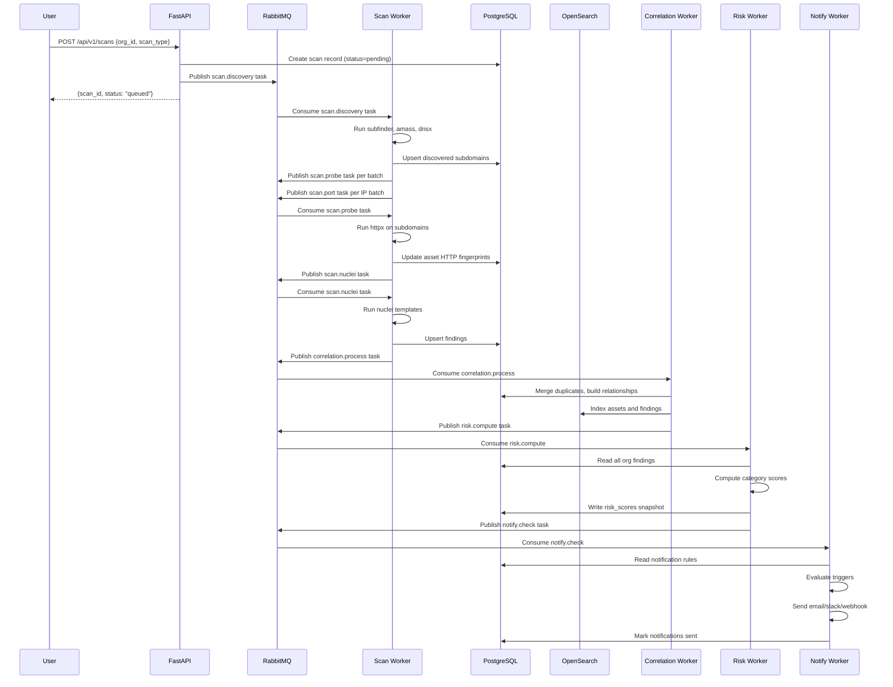
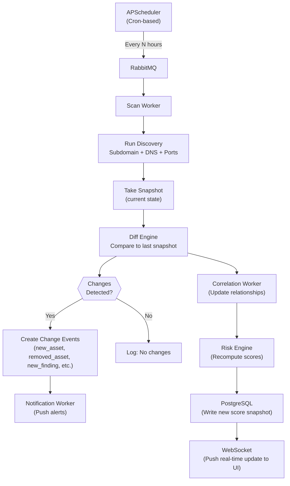
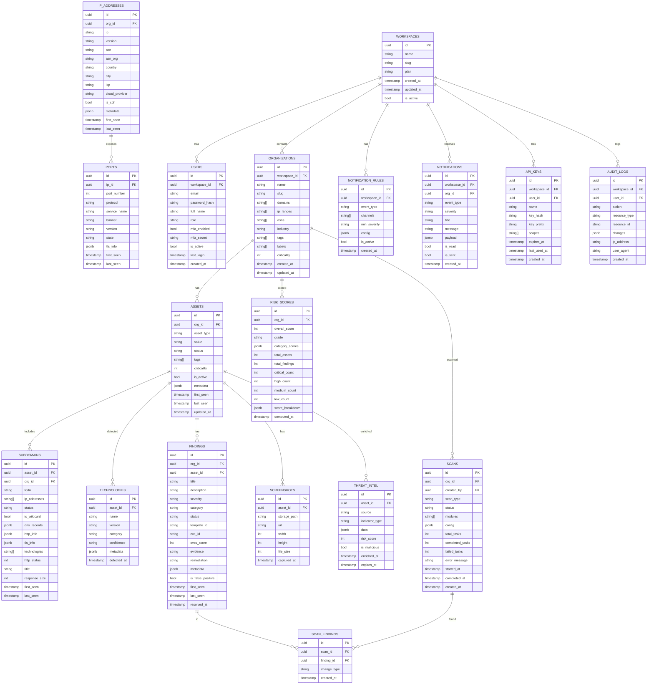
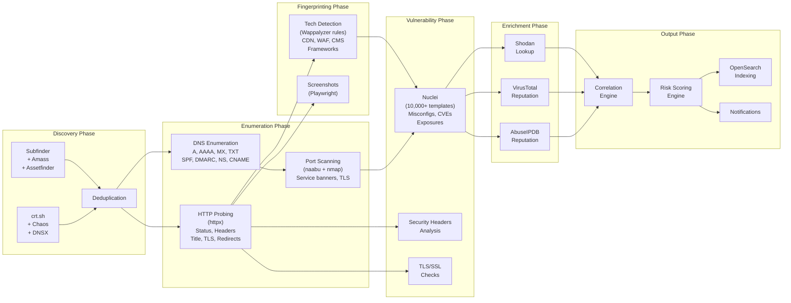
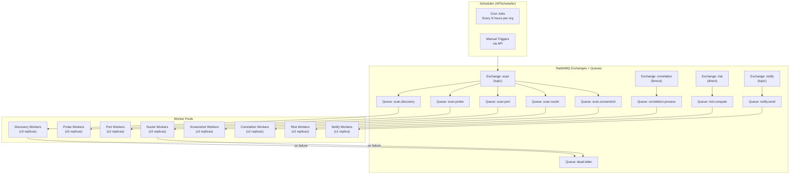
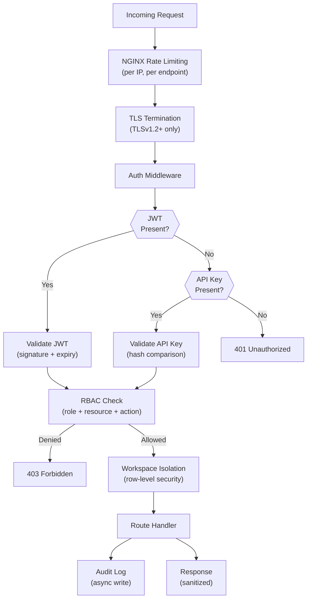

# ASM Platform — Architecture Documentation

## Table of Contents
1. [System Overview](#system-overview)
2. [Architecture Principles](#architecture-principles)
3. [High-Level Architecture](#high-level-architecture)
4. [Service Architecture](#service-architecture)
5. [Data Flow Diagrams](#data-flow-diagrams)
6. [Database Design (ERD)](#database-design)
7. [Scan Pipeline](#scan-pipeline)
8. [Risk Scoring Engine](#risk-scoring-engine)
9. [Worker Orchestration](#worker-orchestration)
10. [API Architecture](#api-architecture)
11. [Security Model](#security-model)
12. [Deployment Guide](#deployment-guide)
13. [Scaling Guide](#scaling-guide)

---

## 1. System Overview

**ASM Platform** is a production-grade, self-hosted Attack Surface Management and External Security Posture Management platform. It provides continuous external asset discovery, exposure tracking, risk scoring, and security posture visibility for security teams, MSSPs, red teams, and enterprise SOC operations.

### Core Capabilities
| Capability | Description |
|---|---|
| Asset Discovery | Automated subdomain, IP, port, service discovery |
| Exposure Management | Continuous vulnerability and misconfiguration detection |
| Risk Scoring | Per-category weighted scoring (0–100) with grade system |
| Threat Intel | Enrichment via Shodan, Censys, VirusTotal, AbuseIPDB |
| Continuous Monitoring | Scheduled scans with diff-based change detection |
| Multi-Tenancy | Workspace isolation, RBAC, API keys |
| Executive Reporting | PDF exports, dashboards, trend analytics |

---

## 2. Architecture Principles

- **API-First**: Every capability exposed via versioned REST API
- **Event-Driven**: Scanner → Queue → Correlation → Risk → Notify
- **Immutable History**: All scan snapshots preserved; diffs computed on read
- **Modular Plugins**: Scanner and enrichment integrations as hot-swappable plugins
- **Zero-Trust Internal**: Service-to-service auth via shared secrets + network isolation
- **Observability-First**: Metrics, structured logging, distributed tracing built in

---

## 3. High-Level Architecture



---

## 4. Service Architecture



---

## 5. Data Flow Diagrams

### 5.1 Asset Discovery Flow



### 5.2 Continuous Monitoring Flow



---

## 6. Database Design (ERD)



---

## 7. Scan Pipeline



---

## 8. Risk Scoring Engine

### Category Weights

| Category | Weight | Description |
|---|---|---|
| Network Security | 15% | Open ports, exposed services, firewall presence |
| DNS Health | 10% | SPF, DMARC, DNSSEC, zone transfer |
| Web Security | 15% | Security headers, HTTPS enforcement, CSP |
| TLS Security | 12% | Cert validity, cipher suites, protocol versions |
| Exposure Management | 18% | Exposed admin panels, default creds, sensitive paths |
| Patch Hygiene | 10% | Known CVEs in detected technologies |
| Information Leakage | 8% | Git exposure, debug endpoints, stack traces |
| Reputation Signals | 7% | Threat intel feeds, malicious indicators |
| Misconfiguration Risk | 5% | CORS, clickjacking, open redirects |

### Scoring Formula

```
category_score = 100 - Σ(finding_penalty × severity_weight × confidence × decay_factor)

severity_weights:
  CRITICAL = 25
  HIGH     = 15
  MEDIUM   = 8
  LOW      = 3
  INFO     = 1

decay_factor = e^(-λ × days_since_detection)  # λ = 0.05 (30-day half-life)

overall_score = Σ(category_score × category_weight)

grade_thresholds:
  A = 90–100
  B = 75–89
  C = 60–74
  D = 40–59
  F = 0–39
```

---

## 9. Worker Orchestration



---

## 10. API Architecture

### Endpoint Structure

```
/api/v1/
├── auth/
│   ├── POST   /register
│   ├── POST   /login
│   ├── POST   /refresh
│   ├── POST   /logout
│   ├── POST   /mfa/enable
│   └── POST   /mfa/verify
├── workspaces/
│   ├── GET    /
│   ├── POST   /
│   ├── GET    /{id}
│   ├── PUT    /{id}
│   ├── DELETE /{id}
│   └── POST   /{id}/invite
├── organizations/
│   ├── GET    /
│   ├── POST   /
│   ├── GET    /{id}
│   ├── PUT    /{id}
│   ├── DELETE /{id}
│   ├── GET    /{id}/assets
│   ├── GET    /{id}/findings
│   ├── GET    /{id}/scores
│   ├── GET    /{id}/scans
│   └── GET    /{id}/timeline
├── assets/
│   ├── GET    /
│   ├── GET    /{id}
│   ├── PUT    /{id}
│   ├── DELETE /{id}
│   ├── GET    /{id}/findings
│   ├── GET    /{id}/technologies
│   ├── GET    /{id}/screenshots
│   └── GET    /{id}/intel
├── scans/
│   ├── GET    /
│   ├── POST   /
│   ├── GET    /{id}
│   ├── POST   /{id}/cancel
│   └── GET    /{id}/results
├── findings/
│   ├── GET    /
│   ├── GET    /{id}
│   ├── PUT    /{id}
│   ├── POST   /{id}/false-positive
│   └── POST   /{id}/accept-risk
├── scores/
│   ├── GET    /
│   ├── GET    /history
│   └── GET    /breakdown
├── search/
│   └── POST   /
├── reports/
│   ├── POST   /generate
│   └── GET    /{id}/download
├── notifications/
│   ├── GET    /
│   ├── POST   /rules
│   ├── PUT    /rules/{id}
│   └── DELETE /rules/{id}
├── admin/
│   ├── GET    /users
│   ├── PUT    /users/{id}
│   └── GET    /audit-logs
└── keys/
    ├── GET    /
    ├── POST   /
    └── DELETE /{id}
```

---

## 11. Security Model



### RBAC Matrix

| Role | Read Assets | Write Assets | Run Scans | Manage Users | Admin |
|---|---|---|---|---|---|
| Owner | ✅ | ✅ | ✅ | ✅ | ✅ |
| Admin | ✅ | ✅ | ✅ | ✅ | ❌ |
| Analyst | ✅ | ✅ | ✅ | ❌ | ❌ |
| Viewer | ✅ | ❌ | ❌ | ❌ | ❌ |

---

## 12. Deployment Guide

### Prerequisites
- Docker 24+ and Docker Compose v2+
- 8 CPU cores, 32GB RAM minimum (production)
- 500GB SSD storage

### Quick Start
```bash
git clone https://github.com/your-org/asm-platform
cd asm-platform
cp .env.example .env
# Edit .env with your secrets and API keys
make setup
make up
# Platform available at https://localhost
```

### Production Deployment
```bash
# Pull latest
git pull origin main

# Build images
make build

# Run database migrations
make migrate

# Start all services
make up-prod

# Check health
make health
```

---

## 13. Scaling Guide

### Horizontal Scaling

| Component | Min | Recommended | Max Notes |
|---|---|---|---|
| API (FastAPI) | 2 | 4 | Stateless, scale freely |
| Scan Workers | 3 | 10 | CPU-bound, scale with scan volume |
| Nuclei Workers | 2 | 8 | IO-bound, aggressive scaling OK |
| Screenshot Workers | 1 | 4 | High memory (2GB/worker) |
| Correlation Workers | 2 | 4 | CPU-bound |
| Risk Workers | 1 | 3 | Mostly DB-bound |
| Notify Workers | 1 | 2 | IO-bound |

### Database Scaling
- Read replicas for analytics queries
- Partition `findings` and `audit_logs` by `created_at` (monthly)
- Partition `risk_scores` by `computed_at` (weekly)
- Connection pooling via PgBouncer

### Queue Scaling
- RabbitMQ clustering (3-node minimum for HA)
- Queue priority for critical scans
- Dead-letter queues with 3 retry attempts

---

*Generated by ASM Platform Architecture System*
