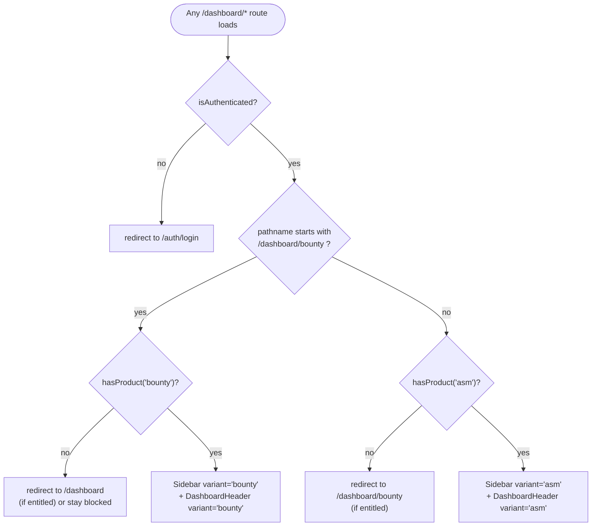

# Frontend

Next.js 14 (App Router), TypeScript, Tailwind CSS. Not containerized for local dev (`cd frontend && npm
run dev`, localhost:3000); the Docker Compose `frontend` service builds a `target: production`
standalone server with **no hot reload** — a `.tsx` change requires
`docker compose build frontend && docker compose up -d --no-deps frontend` to actually show up.

| Library | Version | Role |
|---|---|---|
| `next` | 14.2 | App Router, SSR shell |
| `react` | 18.3 | |
| `zustand` | 4.5 | Global client state (`store/workspace.ts`) — persisted subset to `localStorage` |
| `@tanstack/react-query` | 5.35 | Server-state cache, all API reads/mutations |
| `@tanstack/react-table` | 8.16 | Dense table views |
| `axios` | 1.18 | HTTP client (`lib/api.ts`), with a refresh-token interceptor |
| `react-hook-form` + `zod` | 7.51 / 3.23 | Form state + schema validation |
| `framer-motion` | 11.2 | Page transitions, hover/expand micro-interactions |
| `lucide-react` | 0.378 | Icon set — every icon in the app is one of these, no hand-rolled SVGs, no emoji |

## Two dashboards, one codebase

ASM and Bug Bounty are two fully separate dashboard shells. `dashboard/layout.tsx` picks the variant
purely from the route — see [EXPLANATION.md](./EXPLANATION.md#why-asm-and-bug-bounty-are-two-fully-separate-dashboard-shells)
for why this split exists instead of one shared sidebar:



`components/layout/Sidebar.tsx` takes a `variant: "asm" | "bounty"` prop selecting an entirely
different nav tree (`ASM_NAV_ITEMS` vs. `BOUNTY_NAV_ITEMS`) and branding (icon/title/accent — rose for
Bug Bounty throughout). A **product switcher** ("Switch to ASM"/"Switch to Bug Bounty") appears in the
sidebar only when `enabledProducts` contains both. `components/layout/DashboardHeader.tsx` takes the
same `variant` prop — the organization selector and "Quick Scan" button are ASM-only concepts and are
hidden entirely on the Bug Bounty shell (and the underlying `/organizations` query is `enabled:
!isBounty`, not just visually hidden, so it never fires a request that could only 403).

## App Router structure

```
frontend/src/app/
├── page.tsx                       # bare "/" — no content of its own, waits on
│                                   # Providers.tsx's auth resolution then redirects
│                                   # to /dashboard(/bounty) or /auth/login
├── auth/
│   ├── login/page.tsx
│   ├── register/page.tsx        # product picker (ASM / Bug Bounty / both); reads ?invite_token=
│   │                             # from the URL and switches to an invite-join mode (hides workspace
│   │                             # name + product picker, both ignored server-side on that path)
│   └── forgot-password/page.tsx
├── dashboard/
│   ├── layout.tsx                # auth guard + product guard + shell picker (above)
│   ├── page.tsx                  # ASM overview
│   ├── organizations/            # ASM
│   ├── assets/                   # ASM
│   ├── attack-surface/           # ASM — Clusters / Heatmap / Graph (legacy), see below
│   ├── findings/                 # ASM
│   ├── risks/                    # ASM — risk score detail
│   ├── scans/                    # ASM
│   ├── screenshots/              # ASM
│   ├── dns/                      # ASM — DNS Intel tab
│   ├── tls/                      # ASM — TLS/SSL tab
│   ├── intel/                    # ASM — Network Intel tab
│   ├── reports/                  # ASM
│   ├── bounty/
│   │   ├── page.tsx               # program list
│   │   └── [id]/page.tsx          # program detail — 6 tabs, see below
│   ├── notifications/            # shared (both products)
│   ├── search/                   # shared
│   └── settings/
│       ├── page.tsx                # workspace config + Team Members (list + invite-link generator)
│       ├── api-keys/page.tsx
│       └── profile/page.tsx
└── api/                           # (Next.js route handlers, if any — thin)
```

## Attack Surface Map (`dashboard/attack-surface/page.tsx`)

Three views behind one `view: "clusters" | "heatmap" | "graph"` toggle, defaulting to `"clusters"`:

| View | Data source | Notes |
|---|---|---|
| **Clusters** | `GET /organizations/{id}/network-clusters` | Default. Groups subdomains by shared resolved IP — replaced the node-link graph as the primary view (see `CHANGELOG.md`, 2026-07-15) since the graph became unreadable at real density. |
| **Heatmap** (`components/charts/RiskHeatmap.tsx`) | Same `network-clusters` query as Clusters — no separate API call | Additive third view, added on top without touching the other two (`CHANGELOG.md`, 2026-07-23). Every cluster/standalone host is a grid cell, colored on a continuous emerald→red gradient by a weighted-severity score (critical=4/high=3/medium=2/low=1) normalized against the highest-risk cell in the dataset. Zero-finding cells render neutral rather than "cool green" — matches the GitHub-contribution-graph convention so "nothing happening" doesn't visually compete with real signal. |
| **Graph (legacy)** | `GET /organizations/{id}/attack-surface-graph`, only fetched when this tab is actually selected | The original node-link view (Cytoscape), kept reachable rather than deleted; tech/finding node-type toggles default off to start topology-focused. |

`Clusters` and `Heatmap` share one query (`enabled: view === "clusters" || view === "heatmap"`), so
switching between them is instant with no refetch; `Graph`'s query only runs once that tab is selected.

## `store/workspace.ts` (Zustand)

Single global store covering auth + workspace + UI state:

- `user`, `isAuthenticated`, `isLoading`
- `workspaceId`, `workspaceName`, **`enabledProducts: string[]`** (populated from `/auth/me`'s
  `enabled_products`, which `login()`/`refreshUser()` already receive — no extra API call needed)
- `activeOrg` (ASM-only concept, selected via `DashboardHeader`'s org dropdown)
- `sidebarCollapsed`, `theme`
- RBAC helpers: `hasRole(roles)`, `canWrite()`, `canAdmin()`
- **Product helper**: `hasProduct(product)` — `enabledProducts.includes(product)`, used by every route
  guard and nav-visibility check described above

Persisted subset (`localStorage`, key `asm-workspace`): `workspaceId`, `workspaceName`,
`enabledProducts`, `activeOrg`, `sidebarCollapsed`, `theme`. The JWT itself lives separately
(`lib/api.ts::tokenStorage`, keys `asm_access_token`/`asm_refresh_token`) so a page reload only needs
`Providers.tsx` to call `refreshUser()` once on mount if a token is present.

## Theming and accessibility (structural facts)

- **Theme**: `store/workspace.ts`'s `theme: "dark" | "light"` field, applied as a `.dark` class on
  `<html>`. `Providers.tsx` toggles it on change; a blocking inline script in `app/layout.tsx` sets it
  before first paint from the same persisted `localStorage` key, to avoid a flash of the wrong theme on
  reload. Both palettes are CSS custom properties in `globals.css` (`:root` = light default, `.dark`
  class = dark). `SeverityBadge.tsx` and every severity/grade color reference read the same
  `--severity-*`/`--grade-*` tokens.
- **Modals**: `ScanModal.tsx`, `FindingDetailModal.tsx`, the inline "New Scan" modal in
  `dashboard/page.tsx` — all built on `@radix-ui/react-dialog`.
- **Header dropdowns**: `DashboardHeader.tsx`'s org selector/notifications/user menu — built on
  `@radix-ui/react-dropdown-menu`.
- **Reduced motion**: `Providers.tsx` wraps the app in framer-motion's `<MotionConfig
  reducedMotion="user">`, applying to every animation in the app (page transitions, sidebar width,
  dropdown/modal enter) at once.

See [EXPLANATION.md#theming-and-accessibility](./EXPLANATION.md) for why these exist and what they
replaced.

## Bug Bounty program detail page (`dashboard/bounty/[id]/page.tsx`)

The single most complex page in the app — 6 tabs over one program:

| Tab | Purpose | Notable UI pattern |
|---|---|---|
| Summary | Stat cards, severity distribution bars, priority-bucket samples, "Open HTML Report" | `bucketIcon()` maps a priority-bucket name prefix (idor/bac/auth/upload/payment/webhook/debug/graphql) to a `lucide-react` icon |
| Scope | `scope_rules` CRUD, read-only `rules_of_engagement` JSON | |
| Targets | Approved, testable list | **Grouped/Table toggle** — URLs nest under their parent domain (`groupByDomain()`, exact-hostname match) as collapsible groups, or flip to a dense sortable table. Search + alive/dead filter chips. |
| Recon | Suggestion list, multi-select + bulk-promote | Same Grouped/Table pattern as Targets, plus promoted/not-promoted filter. **Fetches `asset_type=subdomain` as its own parallel query**, merged with the general fetch — the general fetch alone (`page_size=200`, sorted by most-recently-discovered) can come back with zero subdomain rows on a program where recon found 200+ URLs more recently than its subdomains, which would silently break the grouping with nothing to group under (a real bug found validating this against production data — see `CHANGELOG.md`, 2026-07-21). |
| Findings | `ExploitAttempt` list | Search + status (confirmed/candidate) + severity filter chips |
| Reports | `BountyReport` draft accordion | Copy-markdown action |

Shared primitives specific to this page: `SearchInput`, `FilterChip`, `ViewToggle`, `EmptyState`,
`groupByDomain()`. Card hover-lift (`LIFT` class) and smooth expand/collapse (CSS
`grid-template-rows` transition, not `display:none`) are used throughout for consistency, not just on
this page.

## Real-time updates

`lib/api.ts::wsClient` connects to `/ws` once authenticated (`dashboard/layout.tsx`), subscribed per
workspace. Handlers invalidate the relevant TanStack Query cache keys on `score.updated`,
`finding.new`, `scan.progress` events rather than refetching everything — the Bug Bounty program detail
page additionally polls `GET /bounty/programs/{id}` every 3s *while* any pipeline stage is
`queued`/`running` (`refetchInterval` callback inspecting `stage_status`), independent of the WebSocket
channel.
