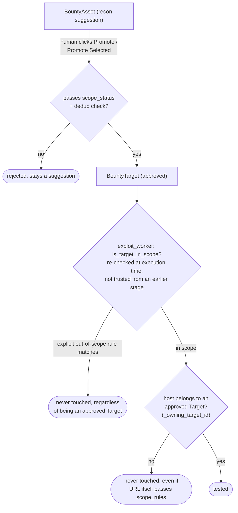

# Pipelines

Two independent pipelines, chained entirely through RabbitMQ publishes — **there is no central
orchestrator**. Each worker does its job, writes to Postgres, and publishes the next stage's message
itself. See `workers/base_worker.py::EXCHANGE_MAP` for the authoritative queue→exchange map (reproduced
below) and [ARCHITECTURE.md](./ARCHITECTURE.md) for how a message gets onto the queue in the first
place (transactional outbox).

## Queue topology

| Queue | Exchange | Type | Consumer(s) |
|---|---|---|---|
| `scan.discovery` | `asm.scan` | topic | `worker-discovery` |
| `scan.port` | `asm.scan` | topic | `worker-port` |
| `scan.crawl` | `asm.scan` | topic | `worker-crawl` |
| `scan.nuclei` | `asm.scan` | topic | `worker-nuclei` |
| `scan.scanner` | `asm.scan` | topic | `worker-scanner` |
| `scan.screenshot` | `asm.scan` | topic | `worker-screenshot` |
| `correlation.process` | `asm.correlation` | **fanout** | `worker-correlation` |
| `risk.compute` | `asm.risk` | direct | `worker-risk` |
| `notify.send` | `asm.notify` | topic | `worker-notification` |
| `enrich.assets` | `asm.enrich` | direct | `worker-enrichment` |
| `asset.validate` | `asm.asset` | direct | `worker-validation` |
| `bounty.recon` | `asm.bounty` | topic | `worker-bounty-recon` |
| `bounty.probe` | `asm.bounty` | topic | `worker-bounty-probe` |
| `bounty.vulnscan` | `asm.bounty` | topic | `worker-bounty-vulnscan` |
| `bounty.exploit` | `asm.bounty` | topic | `worker-bounty-exploit` |
| `bounty.report` | `asm.bounty` | topic | `worker-bounty-report` |

Every worker declares its own exchange/queue/DLQ topology on every connect (not solely
`infrastructure/rabbitmq/definitions.json`) — add a new queue to `EXCHANGE_MAP` or its binding won't
survive a RabbitMQ restart. Each queue gets a `{queue}.dlq` sibling: `BaseWorker` retries a failed
message up to `MAX_RETRIES` (default 3) with exponential backoff (`x-retry-count` header), then
dead-letters it and marks the owning scan/program `failed`.

⚠️ **Three separate copies of this table exist in code** (`workers/base_worker.py::EXCHANGE_MAP`,
`workers/queue_client.py::ROUTING_CONFIG`, `backend/app/core/queue_client.py::ROUTING_CONFIG`) and can
drift — see [ARCHITECTURE.md's drift notes](./ARCHITECTURE.md#docs-vs-reality).

## ASM scan pipeline

```mermaid
flowchart LR
    trigger(["POST /organizations/id/scans"]) -->|outbox| discovery

    discovery["worker-discovery<br/>subfinder/amass/assetfinder/<br/>crt.sh + dnsx"]
    port["worker-port<br/>naabu + nmap"]
    crawl["worker-crawl<br/>httpx + katana"]
    nuclei["worker-nuclei<br/>nuclei templates"]
    scanner["worker-scanner<br/>coverage_worker.py:<br/>subzy, wafw00f, per-tool scans"]
    screenshot["worker-screenshot<br/>Playwright/Chromium"]
    enrichment["worker-enrichment<br/>ASN/RDAP/network baseline<br/>(no third-party keys)"]
    validation["worker-validation<br/>asset_validation_worker.py"]
    correlation["worker-correlation<br/>dedup + relationship building"]
    risk["worker-risk<br/>risk_engine.py, 9 categories"]
    notification["worker-notification<br/>email/slack/discord/telegram/webhook"]

    discovery -->|scan.port + scan.crawl| port
    discovery --> crawl
    port -->|task_coordinator fan-in| gate1{{"all fanned-out<br/>batches done?"}}
    crawl --> gate1
    crawl -.->|module gate| nuclei
    crawl -.->|module gate| scanner
    gate1 -->|scan.nuclei / scan.scanner| nuclei
    gate1 --> scanner
    nuclei -->|task_coordinator fan-in| gate2{{"nuclei + scanner<br/>batches done?"}}
    scanner --> gate2
    gate2 -->|correlation.process, fanout, fires once| correlation
    correlation -->|risk.compute| risk
    risk -->|notify.send, on change| notification

    screenshot -.->|own trigger, not chained| discovery
    enrichment -.->|enrich.assets, own trigger| discovery
    validation -.->|asset.validate, own trigger| discovery
```

`enrich.assets` and `asset.validate` run alongside the main chain on their own triggers, not as a link
in it. `workers/task_coordinator.py` uses Redis counters plus an atomic Lua script
(`mark_terminal_if_all_done`) so the fan-in gate for correlation fires exactly once per scan — not once
per nuclei/scanner batch — even though nuclei/scanner/port/crawl all run as many parallel fanned-out
messages per scan, not one.

A scan's `modules` list (`discovery`, `probe`, `nuclei`, `screenshot`, `scanner`, ...) gates every
downstream stage — each worker must check whether its own stage is in the requested module list before
doing work. (A past bug let a `vuln`-type scan still run discovery because one worker skipped this
check — see `CHANGELOG.md`.)

Progress is pushed to the frontend live over WebSocket via Redis pub/sub
(`asm:events:{workspace_id}`), published by `workers/scan_state.py`. Per-phase status for the scan
detail UI's drill-down is a separate concern, written by `workers/scan_phase.py` into
`Scan.phase_status` (JSONB) and the `ScanPhaseRun` table via Postgres `ON CONFLICT DO UPDATE` upserts —
`workers/scan_observability.py` additionally records *why* each candidate target was selected or
skipped for a phase, into `ScanTargetSelection`.

### Nuclei scan profiles

Named, reusable template-directory sets (`backend/app/services/scan_profiles.py`), picked per scan
rather than hardcoded: `web_baseline`, `endpoint_high_signal`, `network_safe`, `tls_dns`, `takeover`,
`cloud_exposure`, `exposure_misconfig`.

## Bug Bounty pipeline

```mermaid
flowchart LR
    trigger(["POST /bounty/programs/id/run/pipeline<br/>(or run/{stage} for one stage manually)"])
    recon["worker-bounty-recon<br/>subfinder/amass/crt.sh + dnsx<br/>+ katana/waybackurls/gau<br/>+ browser_crawl.py (real SPA execution)"]
    probe["worker-bounty-probe<br/>httpx liveness on approved targets"]
    vulnscan["worker-bounty-vulnscan<br/>nuclei + sensitive-file/CORS/<br/>403-bypass/subzy/GraphQL checks"]
    exploit["worker-bounty-exploit<br/>xss/sqli/ssrf/lfi/idor/csrf/ssti/<br/>nosql/jsonbody/oauth/bac/upload"]
    report["worker-bounty-report<br/>drafts BountyReport from<br/>confirmed findings"]

    trigger -->|bounty.recon, auto_chain=true| recon
    recon -->|bounty.probe| probe
    probe -->|bounty.vulnscan| vulnscan
    vulnscan -->|bounty.exploit| exploit
    exploit -->|bounty.report| report

    recon -.->|BountyAsset rows,<br/>never testable directly| suggestions[("Recon<br/>suggestions")]
    suggestions -.->|explicit human<br/>Promote click, or<br/>promote-bulk| targets[("BountyTarget<br/>(approved, testable)")]
    targets -.-> probe
    targets -.-> vulnscan
    targets -.-> exploit
```

`workers/bounty/bounty_stage.py::NEXT_STAGE` (`recon→probe→vulnscan→exploit→report`) drives the
auto-chain: after a stage finishes with status **completed** (never on `skipped`/`failed`), if the
triggering message carried `auto_chain: true`, the worker publishes the next stage's message itself,
same as the ASM pipeline's chaining. Manual single-stage runs (`POST run/{stage}`) don't set
`auto_chain`, so they never cascade — the two trigger modes are additive, not exclusive.

### The scope gate (the load-bearing safety property of this whole pipeline)

Two independent gates on every single URL the exploit stage ever touches: **(1)**
`is_target_in_scope(url, program.scope_rules)` — explicit out-of-scope rules always beat an in-scope
match, fail-closed; **(2)** the URL's host must belong to a `BountyTarget` a human explicitly approved
(`_owning_target_id`). Recon output (`BountyAsset`) can never expand what's testable on its own — a
discovered URL is only ever touched if a human already approved its parent domain/URL as a target. This
is re-validated inside the worker at execution time on *every* stage, not trusted from upstream, so
narrowing `scope_rules` mid-program takes effect immediately.

### Exploit module reference

| Module | What it tests | Confirmation discipline |
|---|---|---|
| `xss` | Reflected (dalfox), DOM-based (Playwright, unique-token proof), stored (opt-in, see below) | `dom-xss`/`stored-xss` = **confirmed** (token execution has no plausible false-positive path); reflected = confirmed on unescaped reflection |
| `sqli` | Query-param injection (sqlmap) + login-form auth-bypass (baseline-diff) | confirmed |
| `ssrf` | Out-of-band callback via `oob_domain` | confirmed only with OOB hit — no blind/unconfirmable payloads |
| `lfi` | Path traversal, known file-content signatures | confirmed |
| `idor` | Path-shaped object references, cross-identity confirmation (opt-in, two real accounts) | flags a candidate and **stops** — never enumerates/extracts another user's data |
| `csrf` | Missing anti-CSRF protection | inconclusive |
| `ssti` | Math-eval injection with baseline request | confirmed |
| `nosql` | NoSQL operator injection | inconclusive |
| `jsonbody` | Mass-assignment, JSON body mutation | inconclusive |
| `oauth` | JWT `alg:none`, OAuth misconfig | confirmed for `alg:none`, else inconclusive |
| `bac` | Unauthenticated access to privileged endpoints, HTTP method switching | inconclusive |
| `upload` | Unrestricted file upload (dangerous extension accepted), XXE (`/etc/passwd` signature) | upload = inconclusive; XXE = confirmed |
| stored XSS | Fills + submits a real, visible form field with a token payload, checks same-page or post-reload execution | **opt-in only** (`rules_of_engagement.stored_xss_test`) — the one check that creates real, visible content on the target, gated like two-identity IDOR |

`MAX_URLS=200`, `MAX_URLS_PER_MODULE=15`, `MAX_DOM_XSS_URLS=8`, `MAX_STORED_XSS_URLS=5`,
`MAX_TWO_IDENTITY_IDOR_URLS=10`, `MAX_SESSION_DERIVED_URLS=20` bound every run regardless of how wide a
program's scope is. Candidate URLs are priority-sorted (`_priority_score` / `PRIORITY_BUCKETS` in
`backend/app/services/bounty_report.py` — idor/bac/auth/upload/payment/webhook/debug/graphql-shaped
paths first) before truncation, so a pile of CSS/JS assets never crowds out the handful of endpoints
actually worth testing.

### Vulnerable to SPA-only client-side rendering — and how recon compensates

Every static crawler (katana, waybackurls, gau) only parses HTML/JS text — none of them execute
JavaScript, so a modern SPA's real routes and API calls (built entirely client-side, often carrying
real per-user resource IDs) are invisible to them. `browser_crawl.py` drives a real headless browser
instead: loads the app, passively captures every network request it fires, clicks through internal
links (`a[href]`/`[routerlink]` only — never a plain button, to avoid triggering a state-changing
action), and — as of the most recent recon work — also types into any search-style input it finds and
captures the resulting URL, since a hash-routed SPA's `#/search?q=...` route is built entirely
client-side and never touches the network at all. `exploit_dom.py`'s param injection correspondingly
parses query params from *either* the real query string or a hash-fragment-embedded one, for the same
reason.
