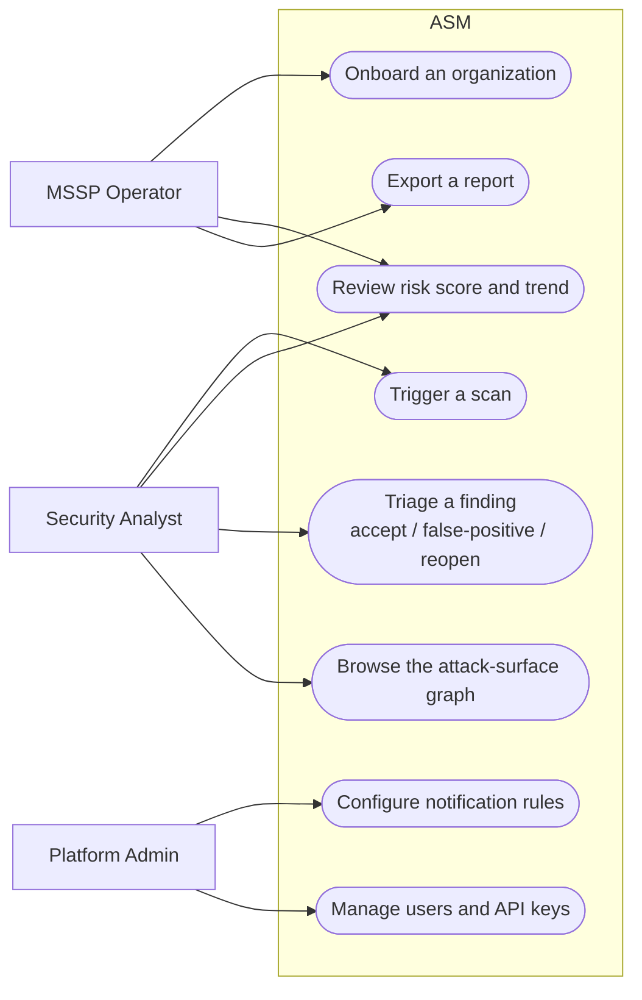
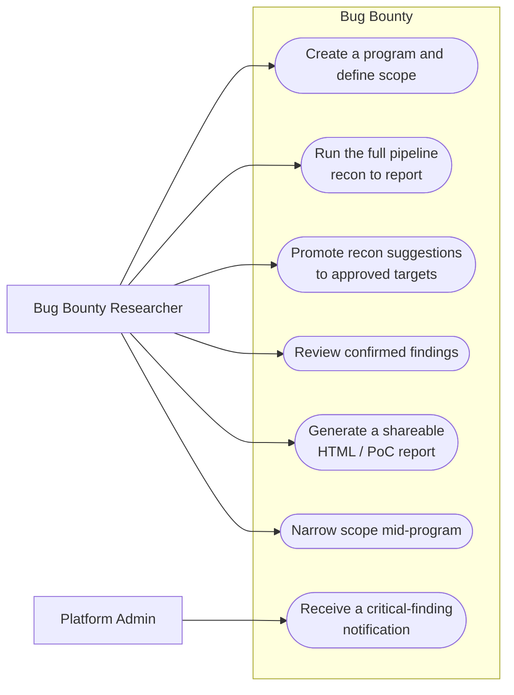
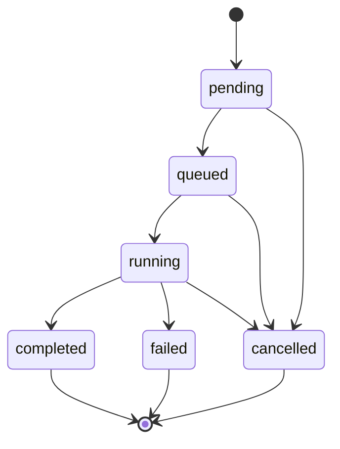
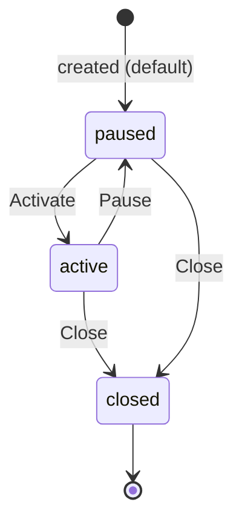
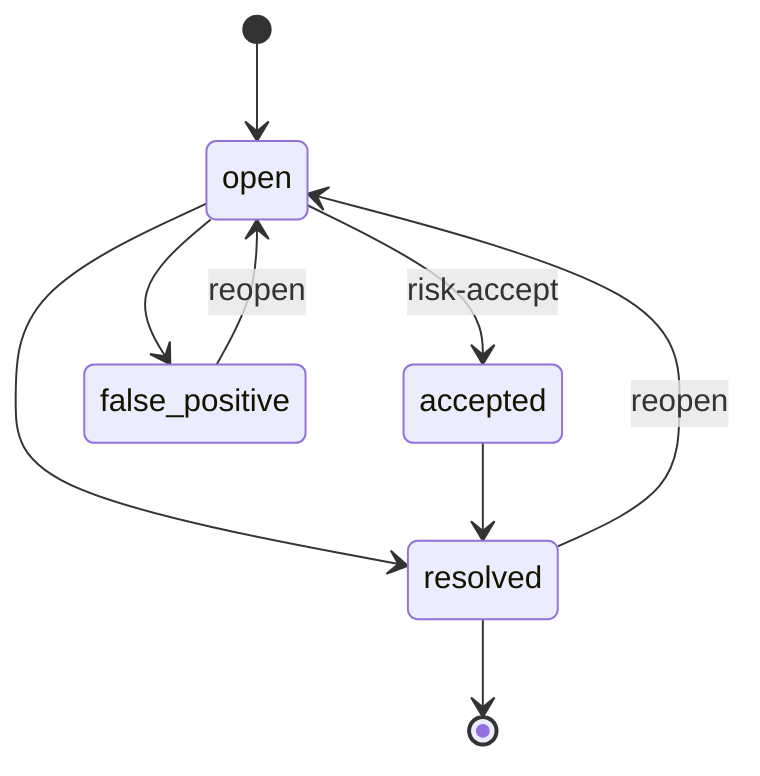
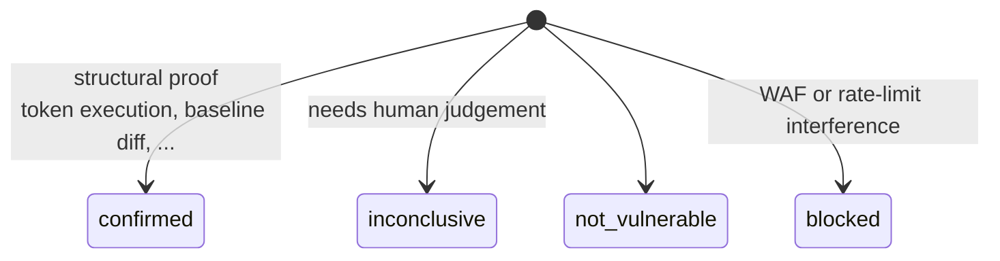

# Product Requirements Document (PRD)

**Status**: living document, describing the product as it actually exists (2026-07-21), not an
aspirational pre-build spec. Where a requirement is met, it says so; where it isn't yet, it's marked
explicitly rather than implied.

> A product-planning document, not user- or developer-facing system documentation — it sits outside the
> [Diátaxis](https://diataxis.fr) Tutorial/How-to/Reference/Explanation structure the rest of `docs/`
> follows (see [README.md](./README.md)), deliberately, rather than being forced into one of those
> modes. For the half-page, non-technical version, see [EXECUTIVE_SUMMARY.md](./EXECUTIVE_SUMMARY.md).

## 1. Vision

A self-hosted platform a security team fully owns and controls — no data leaves their infrastructure,
no per-seat SaaS pricing — that covers both sides of external security posture work from one login:

1. **Know what you have and how exposed it is**, continuously, without anyone having to remember to run
   a scan (Attack Surface Management).
2. **Prove exploitability, safely and within explicit authorization**, when passive discovery isn't
   enough and a real bug bounty engagement calls for active testing (Bug Bounty).

The two are related but intentionally not the same product wearing two hats — see
[docs/EXPLANATION.md#why-two-pipelines-not-one](./EXPLANATION.md#why-two-pipelines-not-one). A
workspace picks one or both at signup.

## 2. Problem statement

- Security teams and MSSPs need continuous visibility into an organization's internet-facing footprint
  — subdomains, IPs, ports, endpoints, TLS/DNS posture — without manually re-running discovery tooling
  and manually eyeballing diffs.
- Raw scanner output (nuclei findings, open ports, expired certs) doesn't answer "how worried should I
  be, and about what, first" — it needs weighting, deduplication, decay over time, and a single
  score/grade a non-specialist stakeholder can track.
- Bug bounty hunters and internal red teams need a way to go from "here's my authorized scope" to "here
  are confirmed, reproducible findings with step-by-step PoCs" without hand-running the same recon → probe →
  exploit → writeup sequence for every engagement, while never risking testing something out of scope.

## 3. Target users / personas

| Persona | Uses | Primary need |
|---|---|---|
| Security team / SOC analyst | ASM | Continuous exposure visibility, prioritized findings, risk trend over time |
| MSSP managing multiple client orgs | ASM | Multi-tenant isolation (workspace → organization), per-org scoring, white-label-able dashboard |
| Internal red team | ASM + Bug Bounty | Both continuous monitoring of their own org *and* active testing against explicitly-approved scope |
| Bug bounty researcher (HackerOne/Bugcrowd/independent) | Bug Bounty | Fast recon-to-report pipeline for an authorized program, with scope enforcement that can't be accidentally bypassed |
| Platform owner / admin | Both | User/workspace management, audit trail, notification routing |

## 4. Use cases

Mermaid has no native UML use-case notation (no actor/oval/system-boundary primitives), so this uses
the standard workaround: actors as boxes, use cases as pill/stadium shapes, grouped inside a
system-boundary subgraph — same information a formal use-case diagram carries.

### ASM

### Bug Bounty

## 5. Reference benchmark

The product-completeness bar for ASM is **Tenable's Attack Surface Management product** — when scoping
new work or judging whether a feature is "done enough," compare against what a product at that tier
would offer, not just internal consistency.

## 6. Product scope

### 6.1 Attack Surface Management (ASM)

| Capability | Status |
|---|---|
| Multi-tenant workspace → organization → asset hierarchy | ✅ shipped |
| Subdomain/DNS/IP/port discovery (subfinder, amass, assetfinder, crt.sh, dnsx, naabu) | ✅ shipped |
| HTTP fingerprinting, web crawling, endpoint scoring (httpx, katana) | ✅ shipped |
| Vulnerability scanning (nuclei), named scan profiles | ✅ shipped |
| Correlation / dedup / asset-relationship graph | ✅ shipped |
| Weighted, decaying risk score with letter grade | ✅ shipped — see [DEVELOPMENT.md](./DEVELOPMENT.md#risk-scoring-formula) |
| CVSS + EPSS + CISA KEV + SSVC-informed exploit-likelihood boosting | ✅ shipped (4-stage risk-engine redesign) |
| End-of-life software detection | ✅ shipped |
| Screenshots | ✅ shipped |
| Enrichment | ✅ shipped, **keyless only** (ASN/RDAP/network baseline) — see [EXPLANATION.md's threat-intel note](./EXPLANATION.md#docs-vs-reality) |
| Notifications (email/Slack/Discord/Telegram/webhook) | ✅ shipped, on-demand triggers only |
| Scheduled/recurring daily-summary reports | 🚫 explicitly not wanted — reports stay on-demand only (`POST /reports/generate`), confirmed by the project owner 2026-07-28; not a gap to fill |
| Continuous/passive monitoring without a manual scan trigger | ❌ not started — bigger architecture lift, explicitly deferred |
| PDF/CSV reports (executive/technical/compliance/custom) | ✅ shipped — `executive`/`technical` are real; `compliance` maps every finding to a CIS Controls v8 Control + Safeguard (display-only); `custom` is still a plain alias of `technical`, no section-picker built |

### 6.2 Bug Bounty

| Capability | Status |
|---|---|
| Program creation with explicit scope rules (fail-closed, explicit-deny-wins) | ✅ shipped |
| Recon → suggestion list, never auto-promoted to testable | ✅ shipped |
| Real-browser (Playwright) recon of SPA-only client-side routes | ✅ shipped |
| Bulk asset promotion (checkboxes + multi-select) | ✅ shipped |
| Full auto-chained pipeline (one button, recon→...→report) | ✅ shipped |
| 12 active-exploit modules (XSS/SQLi/SSRF/LFI/IDOR/CSRF/SSTI/NoSQL/mass-assignment/OAuth/BAC/upload+XXE) | ✅ shipped — see [PIPELINES.md](./PIPELINES.md#exploit-module-reference) |
| Two-identity IDOR / BAC confirmation | ✅ shipped, opt-in (needs a second, disposable test identity) |
| Stored-XSS confirmation | ✅ shipped, opt-in (creates real content on the target) |
| Subdomain takeover detection (subzy) | ✅ shipped |
| Step-by-step PoC generation in shareable HTML report | ✅ shipped |
| Critical/confirmed-finding notifications | ✅ shipped, reuses the ASM notification pipeline |
| Auto-scope-sync from HackerOne/Bugcrowd APIs | ❌ not built — scope is entered manually |
| Destructive/DoS testing | ❌ explicitly out of scope by default, not a gap |
| Data exfiltration / persistence beyond proof-of-concept | ❌ explicitly out of scope, not a gap |

## 7. Entity lifecycles

Where a status field drives real product behavior (what a user can or can't do next), the intended
lifecycle — these are the state machines a user actually experiences, distinct from the ERD in
[DATA_MODEL.md](./DATA_MODEL.md), which shows structure, not behavior over time.

### Scan status

`workers/scan_state.py` codifies exactly these two sets — `ACTIVE_STATUSES = {pending, queued, running}`,
`TERMINAL_STATUSES = {completed, failed, cancelled}`. A scan cannot be revived from a terminal state; the
user triggers a new scan instead.

### Bug Bounty program status

Only `active` allows any pipeline stage to actually run — every stage worker checks this independently
(see [PIPELINES.md](./PIPELINES.md)). Note this diagram describes the **supported product flow** (what
the frontend exposes: Activate/Pause buttons), not a strict database-enforced state machine — the update
endpoint validates `status` is one of the three valid *values*, not that the specific transition is
legal, so a direct API call could technically write `closed → active`. Don't rely on the API to reject
an unsupported transition; the frontend not offering the button is the actual guard today.

### Finding status (ASM)

### Bug Bounty finding status (`ExploitAttempt`)

Deliberately **not** a mutable workflow like ASM's `Finding` — each row is a point-in-time result of one
test execution, not a ticket a human transitions through states. A human's judgement call on an
`inconclusive` result is captured downstream, in the `BountyReport` draft, not by mutating the attempt
itself.

## 8. Functional requirements

Numbered for reference; "the system" means the relevant combination of API + worker(s) unless a layer
is specified.

**Tenancy & Auth**
- FR-1: A user registering self-service **always** creates a new workspace (no join-existing-workspace
  flow exists today).
- FR-2: A workspace declares which product(s) it's entitled to (`enabled_products`) at registration;
  this is enforced server-side on every request to a product-gated router, not just hidden client-side.
- FR-3: Users have one of 4 roles (`owner/admin/analyst/viewer`) with a strict hierarchy; sensitive
  mutations require `admin` or `owner`.
- FR-4: Authentication supports both short-lived JWT (with refresh rotation) and long-lived API keys
  (scoped, hashed, revocable).
- FR-5: MFA (TOTP) is supported and enforceable per-user.

**ASM**
- FR-6: An organization's discovery seed data (domains, root domains, IP ranges, ASNs) drives
  subdomain/IP discovery without further manual input.
- FR-7: A scan's `modules` list gates every downstream worker stage — a worker must not do work outside
  its requested module list.
- FR-8: Findings are deduplicated via a stable fingerprint (SHA-256) so re-discovering the same issue
  across scans doesn't create duplicate rows.
- FR-9: A finding can be marked false-positive or risk-accepted, excluding it from score computation
  without deleting the record.
- FR-10: Risk score is computed per-organization, versioned (`score_version`), and historized (one row
  per computation, not upserted).

**Bug Bounty**
- FR-11: A `BountyAsset` (recon suggestion) is never automatically promoted to a `BountyTarget`
  (testable) — promotion is always an explicit human action (single or bulk).
- FR-12: Every URL the exploit stage touches must pass two independent checks at execution time:
  `is_target_in_scope` against current `scope_rules`, and ownership by an approved `BountyTarget`'s
  host. Neither check is trusted from an earlier pipeline stage.
- FR-13: IDOR confirmation never enumerates or extracts another identity's data — it stops at the first
  structural confirmation.
- FR-14: A confirmed finding (never a candidate/inconclusive one) can trigger a real-time notification
  through the existing ASM notification channels.
- FR-15: A program's pipeline can be run stage-by-stage (manual) or fully auto-chained (one trigger);
  both paths must respect the program's `active`/`paused`/`closed` status.

## 9. Non-functional requirements (summary — full detail in TRD)

See [TRD.md](./TRD.md) for the complete non-functional requirements (performance, scalability,
security, reliability, observability). Headline points:

- **Security is the primary non-functional requirement for Bug Bounty specifically** — the scope-gate
  model (FR-12) is treated as the single most safety-critical piece of code in the platform.
- Every pipeline stage must be independently horizontally scalable (`docker compose up -d --scale
  worker-X=N`), with no stage assuming a specific concurrency.
- No message is ever lost between "the API committed the decision" and "the queue received it"
  (transactional outbox — see [ARCHITECTURE.md](./ARCHITECTURE.md#request-flow-creating-an-asm-scan-outbox-pattern)).

## 10. Out of scope / non-goals (current)

- Continuous/passive monitoring without a manual scan trigger for ASM.
- Auto-scope-sync from bug bounty platform APIs.
- Scheduled/recurring report generation — reports stay on-demand only
  (`POST /reports/generate`), confirmed by the project owner (2026-07-28); not a gap to fill later.
- Any form of active exploitation beyond proof-of-concept (no data exfiltration, no persistence, no
  destructive/DoS testing) — a deliberate, standing product boundary, not a backlog item.
- Third-party paid threat-intelligence integration (Shodan/VirusTotal/AbuseIPDB/OTX/Censys) — a
  deliberate design decision (no dependency on paid/entitled APIs), revisit only with the project owner.
- Per-user product entitlement within a shared workspace (today it's workspace-wide).

## 11. Current priorities & roadmap

**Core scanning/detection maturity stays the priority** over adjacent feature work — coverage, finding
validity/triage correctness, exploit-intelligence accuracy (EPSS/KEV/SSVC), tool parameter tuning (rate
limits, timeouts, concurrency, flags) over "is the tool wired at all." Benchmark for "proper" is Tenable's
Attack Surface Management product (see §5) — not internal completeness.

### ASM methodology roadmap (from the 2026-07-30 self-audit)

A full-repo review of the ASM pipeline's data-collection, validation, and vulnerability-scanning
methodology (Bug Bounty pipeline explicitly excluded — separately scoped, see §6.2). Phased by
impact, not by effort — Phase 1 items are prioritized first because they're places the platform
*believes* it has current, validated data when it doesn't, which quietly undermines every downstream
feature (risk scoring, notifications, dashboards) built on top of that data. Coverage gaps (Phase 3) are
lower priority than correctness gaps (Phase 1-2) even though they're individually easier to fix.

**Phase 1 — Validation is silently not validating — DONE (2026-07-30)**
- Re-validation (`workers/validation/asset_validation_worker.py`) now runs a real batched `dnsx`+`httpx`
  recheck before scoring (previously scored stale cached fields and stamped `last_verified_at = now`
  regardless), and IP assets get a bounded real TCP connectivity check against previously-known open
  ports instead of trusting a field this worker never updated.
- Liveness detection gained a `"parked"` state (`classify_liveness_content()` in
  `backend/app/services/asset_validation.py`) — a soft-404/CDN-placeholder/parked-domain page is no
  longer indistinguishable from a real live service, via title-keyword matching and cross-asset
  duplicate-response-hash detection. Excluded from scanning automatically (`SCANNABLE_LIVENESS_STATUSES`
  is unchanged, already `{"alive"}` only). See `CHANGELOG.md` for full detail and live verification.

**Phase 2 — Ownership confidence for network (IP) assets — DONE (2026-07-31)**
- `workers/validation/asset_validation_worker.py::_validate_ip_asset` now reads `is_cdn` (already
  computed by `enrichment_worker.py::_classify_provider`, previously unused) and caps
  `ownership_confidence` at 0.35 for shared-CDN IPs (Cloudflare/Akamai/Fastly) — applied after
  `merge_rdap_evidence`, which otherwise independently re-inflates confidence for almost any IP with ASN
  data. See `CHANGELOG.md` for live verification. Two adjacent ideas scoped out after investigation, not
  attempted: tightening CDN detection for CloudFront specifically isn't fixable by text-matching alone
  (needs AWS's `ip-ranges.json`, a separate feature); excluding CDN IPs from active network-target
  scanning would touch `scan_profiles.py`/`discovery_worker.py` (the hottest scan path) and has a real
  ordering problem (a newly-discovered IP has no enrichment data yet when first targeted) — a bigger,
  separately-scoped architectural change if revisited later.

**Phase 3 — Discovery breadth — PARTIALLY DONE (2026-07-31)**
- ~~Katana crawl depth defaults to 1 outside `deep_authorized`~~ — **disproven during investigation**:
  directly computing the real effective scan config confirmed `scan_type="full"` always resolves
  `crawl_depth=3` regardless of scan profile (`DEFAULT_SCAN_CONFIG["full"]` sets it before profile-merging
  happens); only `"quick"` gets depth 1, deliberately. Not a real gap — dropped, not implemented.
- IP/ASN footprint discovery: `discovery_worker.py::_discover_org_asns` now auto-suggests candidate ASNs
  (for orgs that haven't manually entered any) via RIPEstat's free/keyless `searchcomplete` API, with a
  conservative significant-word match filter to avoid generic-name false positives. Feeds the existing
  candidate-only, never-auto-scanned pipeline at lower confidence than manually-entered ASNs. While
  regression-testing this, found and fixed a real, load-bearing pre-existing bug: `_expand_asn_targets`'s
  whois.cymru-based prefix lookup had returned **zero real prefixes for every ASN, manual or auto**, since
  it was first built (Milestone 17) — it expected a 7-field per-prefix response but whois.cymru's bulk
  protocol actually returns a 5-field ASN-info summary row for this query shape. Replaced with RIPEstat's
  `announced-prefixes`/`as-overview` endpoints. See `CHANGELOG.md` for full live verification.
- Wildcard DNS detection: probe count raised 3→6 (round-robin/load-balanced backends could go undetected
  at 3 samples); `Subdomain.is_wildcard` (existed in the schema, never populated) now set for surviving
  hosts whose DNS answer still matches the domain's wildcard fingerprint.
- **Cloud discovery beyond storage buckets — investigated, deferred by decision (2026-07-31), not a gap
  to silently fill later.** Serverless/API-gateway targets (AWS Lambda Function URLs, API Gateway default
  domains, GCP Cloud Run) turned out to be un-guessable at all — each includes a random hash/ID with no
  relation to the org's name, confirmed against their real URL shapes. Two options were found genuinely
  feasible and live-tested (Docker Hub public org/repo discovery via its free keyless API; Azure Web App
  name guessing, which reduces to a DNS-existence check since non-existent names simply don't resolve) —
  the project owner chose not to build either right now. If revisited, the live-tested findings are the
  starting point; no further feasibility research should be needed first.

**Phase 4 — Exploit-intelligence freshness**
- SSVC (`ssvc_exploitation`/`ssvc_automatable`, sourced from cve.circl.lu CVE records) is frozen into
  `Finding.proof` at scan time and never refreshed, unlike EPSS/KEV which are refreshed daily by the
  scheduler and re-queried live on every 4-hourly risk-compute run. Closing this needs a new scheduled
  job (comparable in scope to `exploit_intel_refresh`) — a real feature addition, not a small fix;
  explicitly deferred by the project owner (2026-07-30) rather than started reflexively.

**Recently closed** (2026-07-30, same audit cycle, see `CHANGELOG.md` for full detail): unused nuclei
`workflows/`/`network/misconfig` template categories wired in; naabu port-range silently falling back to
top-100 for the `limited` profile; subdomain-takeover confidence dampening (plus an unrelated template-
miscategorization bug caught while testing it); finding-fingerprint URL/casing normalization, including a
verified, zero-collision production data migration.

**Deferred, explicitly not dropped**:
- Platform self-security: `worker-notification`'s `docker-compose.yml` environment block still omits
  every `SMTP_*` var, so email notifications silently never send regardless of `.env` config — not fixed
  yet since there's no real SMTP environment to verify delivery against in this phase (dev-treated-as-
  prod); revisit once real SMTP credentials exist. (`POST /workspaces/invite` and the suspected cross-
  tenant leak, the other two items from this same earlier assessment, are resolved/ruled-out — see
  `CHANGELOG.md`, 2026-07-28/22.)
- `findings.py::bulk_action`'s bulk UPDATE statements don't re-assert `workspace_id` in their own `WHERE`
  clause (only the pre-check SELECT does) — not currently exploitable, inconsistent with the defense-in-
  depth pattern used elsewhere; still low priority.

**No longer deferred**: Dependency/library CVE remediation — **done** (2026-07-29/30): backend+workers
91→1 CVEs (the 1 remaining is a documented, accepted risk), plus the Next.js 14→15 major upgrade
(including 2 further transitive CVE fixes it exposed). See `CHANGELOG.md`.

**Frontend changes**: small display/readability fixes can proceed without asking; anything that amounts
to a visual revamp needs a heads-up first (this document included — see the Bug Bounty dashboard redesign
in `CHANGELOG.md`, 2026-07-21, for the pattern that was followed: mockup review before implementation).

## 12. Open questions

- Whether real-world finding *volume* from the exploit-intelligence stack (version-CVE correlation,
  EOL detection) needs tighter scoping/bounding on some deployments, or is accepted as-is — flagged
  during the risk-engine redesign, not yet resolved either way.
- Whether `technical`/`compliance`/`custom` report formats need real framework-mapping built out, or
  whether the `executive`-format-is-real / others-are-aliases split is acceptable long-term.
- Whether per-user (not just per-workspace) product entitlement is ever needed for larger teams sharing
  one workspace across both products.
